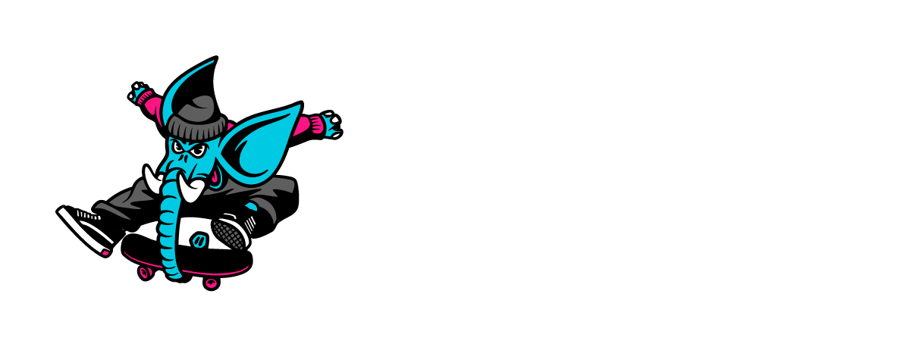

<p align="center">
  
</p>

<h2 align="center">
  The zero-trust framework for autonomous AI agents.
</h2>

<p align="center">
  <a href="https://scorecard.dev/viewer/?uri=github.com/calebfaruki/sycophant"></a>
  <a href="https://deepwiki.com/calebfaruki/sycophant"></a>
  <a href="https://www.rust-lang.org/"></a>
  
  <a href="LICENSE"></a>
</p>

Sycophant runs autonomous AI agents inside a Kubernetes cluster built on least privilege, zero knowledge, and defense in depth. Everything the agent produces is treated as adversarial.

> **Pre-release and under active development.** The architecture below is the design the project is built around. Expect sharp edges.

## Why Sycophant

Most agent frameworks are built for capability, not containment. Isolation is something you bolt on, if you remember to.

Hosted platforms take the other extreme. The model, your data, and the agent all run on their infrastructure. You get controls, but they are settings on machines you do not own, backed by promises you have to trust.

Sycophant is neither. Your data lives on infrastructure you choose. The agent answers only to the people, and their bound chat handles, you grant. Containment is the default, not an add-on.

## What a compromised agent can't do

Assume the agent is fully subverted: prompt injection, a poisoned tool, a bad model. It still cannot:

- **Read a secret.** Model keys and tool credentials exist only inside short-lived jobs, for the seconds a call needs them.
- **Call the network freely.** The agent has no direct egress. Every outbound route is a broker with an explicit allowlist.
- **Break out of a tool.** Each tool runs in its own throwaway sandbox with only the credentials and network access it declared.
- **Rewrite its own history.** The conversation log is owned by a separate component the agent can't write to.
- **Reach another tenant.** Every tenant has its own network, storage, and identity, with no route from one tenant into another.

## How the guarantees hold

Isolation comes from Kubernetes itself. Each tenant is a namespace. Each component is a pod. Every model or tool call runs in a short-lived throwaway pod. The agent's files live on one workspace volume that its tool pods share. That volume is the agent's own space. Secrets, tokens, and network access are not shared, and none outlive the pod that used them.

- **Brokered credentials.** The agent asks a broker by name. The broker gives each call its own throwaway pod, and only that pod ever holds the secret. Neither the agent nor the broker sees it.
- **Scrubbed output.** A tool sometimes needs credentials to run. Before its output returns to the agent, every appearance of those credential values is replaced with a redaction marker. The same scrub runs on model output. The agent gets results, never keys.
- **A worthless identity.** The agent's pod has no RBAC and mounts no token by default. And each token it does use only works with one service. No privilege escalation.
- **Separation, not permission.** The conversation log lives on a volume the agent's pod never mounts. The agent cannot rewrite history because it cannot touch the file.
- **Closed by default.** Cilium gives every pod a default-deny egress firewall. gVisor sandboxes the pods that run agent-written code, so a container escape stops at the sandbox and never reaches the host.
- **Enforcement out of reach.** Kyverno creates each tenant's RBAC when its namespace appears, and blocks edits to the security resources from inside that namespace. The agent cannot reach its own admission policies.

Sycophant uses Chainsaw integration tests against a live cluster to validate security rules. Each test tries a forbidden action and checks that the cluster refuses.

## Quickstart

Sycophant ships as Helm charts. There are two ways in.

**CLI — local, secure by default.** The `sycoadm` CLI stands up a local [k3d](https://k3d.io) cluster with the full capability stack ([see Requirements](#requirements)) already wired in, then installs the hello-world pieces in [`examples/sycoadm/`](examples/sycoadm/). You need Docker, k3d, Go, a Rust toolchain with the `aarch64-unknown-linux-musl` target, jq, helm, kubectl, Tailscale, and the GGUF model at `~/.cache/sycophant/weights/Qwen3.5-2B-Q4_K_M.gguf`.

```sh
make sycoadm syco
export PATH="$PWD/target:$PATH"

# Create the cluster. Prompts for an operator email and password; idempotent.
# Every `up` below prompts for that password and waits for its installer.
sycoadm setup

sycoadm tenant up -f examples/sycoadm/tenants/hello-world.yaml

# The model server and weights images the inference example names.
docker pull ghcr.io/ggml-org/llama.cpp:server@sha256:9f84380be42d6285a827629c809387349c3541aa8986f7536547ca33cc8dd47a
docker tag ghcr.io/ggml-org/llama.cpp:server@sha256:9f84380be42d6285a827629c809387349c3541aa8986f7536547ca33cc8dd47a llama-server:local
docker build -f build/weights.Dockerfile --build-arg GGUF=Qwen3.5-2B-Q4_K_M.gguf \
  -t weights:local ~/.cache/sycophant/weights

sycoadm inference up -f examples/sycoadm/inference/qwen3-5-2b.yaml
sycoadm toolset up -f examples/sycoadm/toolsets/hello-world/values.yaml

# The demo secret the workspace grants as hello-world/demo-key. Keep it on one
# line: the scrubber redacts single-line values.
printf '%s' 'hello-world-demo-secret-DO-NOT-USE' \
  | sycoadm tenant secret set demo-ssh-key --ns tenant-hello-world

sycoadm workspace up -f examples/sycoadm/workspaces/hello-world.yaml

sycoadm instructions up -f examples/sycoadm/instructions/hello-world.yaml

sycoadm channel up -f examples/sycoadm/channels/tailnet.yaml

# Join the tailnet. Needs sudo; once per machine.
sycoadm connect --tenant hello-world

# Point syco at the relay on the tailnet.
mkdir -p ~/.config/syco
sed 's/${TAILNET_RELAY_ADDR}/relay:9090/' examples/syco/config.toml > ~/.config/syco/config.toml

syco login --email e2e-operator@sycophant.local
sycoadm user up -f examples/sycoadm/users/alice.yaml \
  --set "user.subject=https://127.0.0.1:30443/dex#$(syco whoami | awk '/^Subject:/ {print $2}')"

# Ask the agent to use ShowKernel and to WebFetch https://example.com (it fails:
# the toolset has no egress). With --grant hello-world/demo-key, ask it to use
# GetSecret on demo-ssh-key; the reply shows [REDACTED:demo-ssh-key].
syco chat

# Tear down one piece, or everything.
sycoadm workspace down hello-world --tenant hello-world
sycoadm destroy
```

`sycoadm upgrade` never touches channels. A cluster that ran the old `app` channel replaces it after the upgrade with `sycoadm channel down app --tenant <tenant>` and the `channel up` above. The new channel joins the tailnet as a new node; nothing is migrated, and clients reconnect.

**DevOps — your own cluster.** Install the charts with Helm. The `sycophant-quickstart` chart bundles the gVisor RuntimeClass and Kyverno CRDs, so one command gives you a working cluster:

```sh
kubectl apply -f charts/sycophant-cluster/system-ns.yaml

helm install sycophant charts/sycophant-quickstart \
  -n sycophant-system --wait
```

Already provide your own RuntimeClass and CRDs ([see Requirements](#requirements))? Skip the bundle and install the cluster layer alone:

```sh
helm install sycophant charts/sycophant-cluster \
  -n sycophant-system --wait
```

## Components

Three components, each with a single, well-defined job. The harness is the broker: the agent asks it for a tool or model by name. For a tool or a remote model, it spins up a throwaway job holding only the credentials and egress that call needs. A local model runs on a warm in-cluster service the harness dials directly, with no credential. Neither secrets nor egress reach the agent.

<p align="center">
  
</p>

| Component | Role |
| --- | --- |
| **Harness** | The agent runtime and broker, one per workspace. Runs the agent loop, owns the conversation history, and reads its own instructions — the workspace's AGENTS.md, sub-agents, and skills — in-process from a read-only volume. Creates each tool call and remote model call as a gated, throwaway job with only the credentials and egress that call needs, and dials a warm local model directly. |
| **Relay** | The client gateway. Authenticated people and channels (person or channel tokens) dial in through it to reach their agent, and it relays messages to and from the harness. |
| **Toolset** | The tool runtime. Runs one tool call inside a throwaway gVisor sandbox the harness creates and tears down. |

Built as a Rust monorepo on gRPC (tonic/prost), Kubernetes CRDs (kube-rs), and Helm charts. The `sycoadm` CLI drives it. Images target Linux arm64 and amd64.

## Requirements

Sycophant runs on any conformant Kubernetes cluster. It relies on three cluster capabilities. Each is a swappable role with a sensible default:

- **Sandboxed container runtime:** a `gvisor` RuntimeClass by default (Kata is a supported alternative). Isolates the toolsets that run agent-executed tool code.
- **Network egress control:** Cilium (default-deny egress with an L7 DNS allowlist).
- **Admission policy engine:** Kyverno 3.9.x, with its CRDs.

`sycoadm setup` installs this default set on a local k3d cluster for you. Running it needs a local toolchain: k3d, helm, kubectl, cargo (rustup), protoc, cmake, and a C compiler.

## Local development

`make` with no arguments lists every target. The local target is a k3d cluster. `scripts/e2e.sh` runs the quickstart above mechanically and asserts the security clauses.

- **macOS stalls on fresh binaries.** XProtect scans each new binary on first run, and a large test binary can sit at 0% CPU for 10+ minutes while `syspolicyd` works. Wait it out; killing it restarts the scan. Adding your terminal under System Settings → Privacy & Security → Developer Tools skips the scans.
- **Docker VM disk, not RAM, is the limit.** A near-full VM trips kubelet eviction and a Kyverno eviction storm that looks like a memory problem. Keep about 15 GB free; `sycoadm setup` refuses under 8 GB.
- **A rebuilt image doesn't replace the running one.** k3d's containerd caches by `name:tag`. Remove the old one before re-importing:

  ```sh
  docker exec k3d-sycophant-server-0 ctr -n k8s.io image rm docker.io/library/<image>:local
  k3d image import <image>:local --cluster sycophant
  kubectl rollout restart deployment/<deployment> -n tenant-hello-world
  ```

- **Stale or broken conversation history.** A harness crash mid-tool-call can leave a log the model rejects (`tool_use without tool_result`). Delete the conversation volume and restart:

  ```sh
  kubectl delete pvc ws-hello-world-conversation -n tenant-hello-world
  kubectl rollout restart deployment ws-hello-world -n tenant-hello-world
  ```

Charts live under [`charts/`](charts/) (`sycophant-quickstart` is the install bundle). The [examples](examples/sycoadm/) show how to write each piece.

## Security

Security is structure, not configuration. Simplicity, not complexity. See [SECURITY.md](SECURITY.md) for reporting and [THREAT_MODEL.md](THREAT_MODEL.md) for the full model.

## Contributing

Contributions are welcome. Open an issue to discuss a change, or send a pull request. Start with the design docs under [`docs/`](docs/) to get oriented.

## License

[AGPL-3.0](LICENSE)

Logo by [Bullitt](https://www.yo-bullitt.com/).
